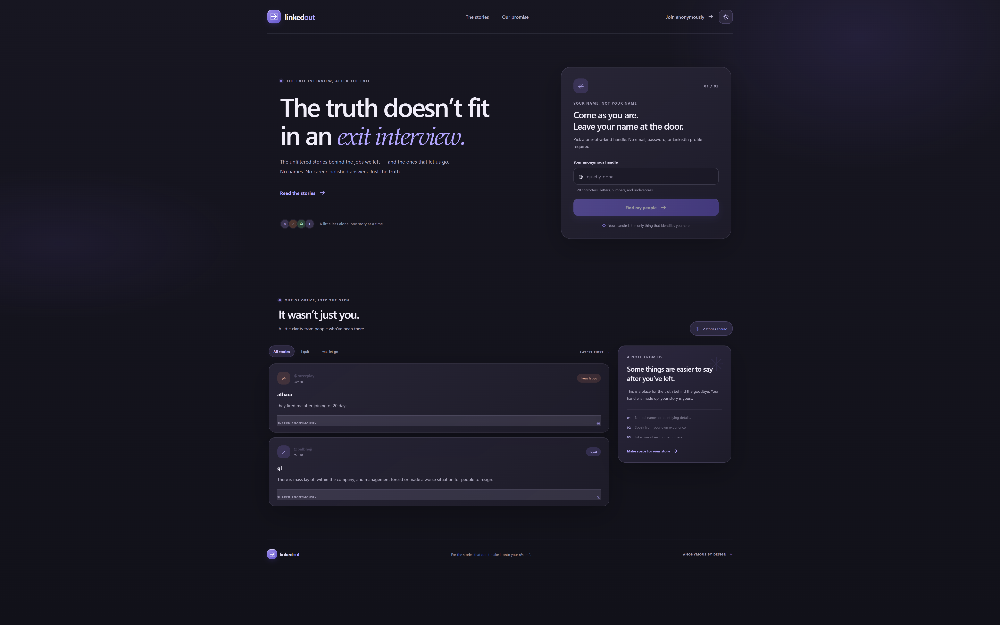

# LinkedOut

**The truth doesn’t fit in an exit interview.**

LinkedOut is a place to share the real reasons people leave a job—or are let go—without signing up with their real name or email. Choose a unique handle, share your experience, and read stories from others.

<p align="center">
  
</p>

[](https://sauravrwt.github.io/linkedout/)

## Features

- Anonymous Firebase Authentication; signup asks only for a unique handle.
- Stories with a company, message, and outcome: **I quit** or **I was let go**.
- Live, newest-first story feed with outcome filters.
- Responsive Liquid Glass interface with a persistent light/dark theme switch.
- Firestore rules for unique handles and validated story submissions.

## Tech stack

- React
- Vite
- Firebase Authentication
- Cloud Firestore

## Get started

### Requirements

- Node.js and npm
- A Firebase project with a registered Web app
- Cloud Firestore in **Native mode**

### Configure Firebase

1. In Firebase Console, enable **Authentication → Sign-in method → Anonymous**.
2. Create a Cloud Firestore database in **Native mode**. Datastore mode is not supported by the Firebase Firestore client SDK. If the project’s default database is in Datastore mode, create a Native mode database with a separate database ID or use another Firebase project.
3. Publish [`firestore.rules`](./firestore.rules) to the same Native mode database the app will use.
4. Copy [`.env.example`](./.env.example) to `.env` and set the Firebase Web app values:

   ```dotenv
   VITE_FIREBASE_API_KEY=your-firebase-web-api-key
   VITE_FIREBASE_AUTH_DOMAIN=your-project.firebaseapp.com
   VITE_FIREBASE_PROJECT_ID=your-project-id
   VITE_FIREBASE_APP_ID=your-firebase-app-id
   VITE_FIREBASE_DATABASE_ID=(default)
   ```

   Set `VITE_FIREBASE_DATABASE_ID` to your Native mode database ID. Use `(default)` only if the default database is in Native mode. Copy plain values from Firebase Console—do not include JavaScript quotes or trailing commas.

### Install and run

```sh
npm install
npm run dev
```

Vite prints the local development URL after startup.

## Build and checks

```sh
npm run build
npm run preview
npm run lint
```

`npm run build` creates the production site in `dist/`; `npm run preview` serves that build locally.

## Hosting

Vite embeds `VITE_*` settings into the frontend at **build time**. Add the required Firebase variables to your hosting provider’s build environment and rebuild/redeploy after changing them. Runtime variables added after the build will not update an existing `dist/` bundle.

For hosted or port-forwarded URLs, add the hostname under **Firebase Console → Authentication → Settings → Authorized domains**. If the API key is restricted by HTTP referrer, allow the site’s origin in that key’s restrictions as well.

Firebase Web app configuration is meant to be used by the browser. Never put service-account credentials or private keys in frontend environment variables.

## Data and privacy

The app stores:

- `usernames/{handle}` — reserves a unique handle for an anonymous Firebase Auth account.
- `users/{uid}` — maps that account to its handle.
- `posts/{postId}` — stores the handle, company, story, outcome, and timestamp.

Stories are publicly readable and cannot be edited or deleted by the client. Handles are unique and cannot be changed through the client. Avoid including real names or details that could identify you or another person.

Review the Firebase configuration, deployed security rules, and abuse protections before making the app publicly available. Consider enabling Firebase App Check for production.
